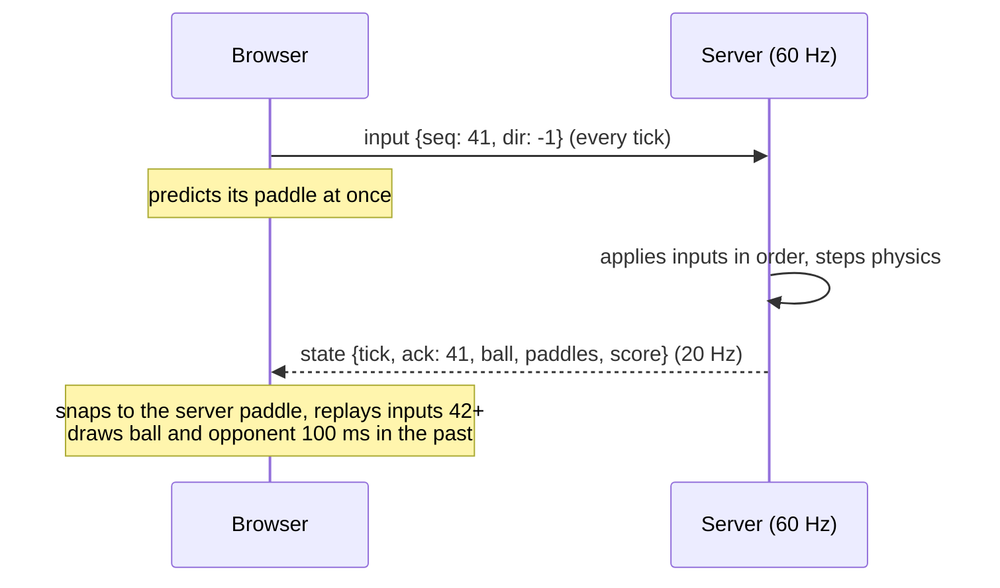

# Rally


A real-time two-player game over WebSockets, built from scratch to show the netcode behind multiplayer games. The server runs the only simulation. Each browser predicts its own paddle so input feels instant, and draws everything else slightly in the past so motion stays smooth. A player can lose their connection mid-match and carry on.

**Live demo:** https://rally-6flz.onrender.com (free instance: the first visit after idling takes about a minute). Play the built-in bot, quick-match a stranger, or share a private room code.

**Stack:** TypeScript · Node.js · `ws` (no game framework) · Canvas · Vite · PostgreSQL · Vitest · Prometheus · Docker · GitHub Actions



## Design

| Concern | Approach |
|---|---|
| **Cheating** | The server is authoritative. Clients send only a direction (`-1/0/1`) with a sequence number, never positions. Every message is validated (shape, ranges, 512-byte frames). Inputs are queued per player, capped at 8 and drained at most 2 per tick, so sending faster never moves faster for more than a few ticks. |
| **Responsiveness** | Client-side prediction runs the same `movePaddle` as the server. Each snapshot carries `ack`, the last input applied, and the client snaps to the server position and re-applies the newer inputs. With correct netcode the correction is 0, and the client shows it live. |
| **Smoothness** | 60 Hz fixed-timestep simulation (drift-free accumulator) and 20 Hz snapshots. The ball and opponent are interpolated 100 ms behind real time, which absorbs jitter. Snapshots are compact (one decimal place). |
| **Disconnects** | Sessions outlive sockets. A dropped player's match pauses for 15 s, a reconnect with the session token (kept in `sessionStorage`) resumes it after a 1 s countdown, and otherwise the opponent wins by forfeit. Clients reconnect with exponential backoff. |
| **Dead connections** | WebSocket ping every 10 s. A socket that missed the previous pong is terminated, because half-open TCP connections send no close. |
| **Slow clients** | Backpressure: a socket with more than 64 KB buffered gets its snapshots skipped (counted in metrics) instead of growing server memory. |
| **Abuse** | A token bucket per connection (90 msg/s, burst 120). Malformed or rate-limited messages are strikes, and 50 strikes close with 1008. Oversized frames close with 1009. There is a connection cap. |
| **Observability** | `/metrics` (Prometheus) reports connections, rooms, queue length, messages by type, rejections, skipped snapshots, tick-time histogram, finished matches by reason, and reconnects. `/healthz` and `/api/stats` are also available. |
| **Determinism** | The physics is a pure step function with a seeded xorshift RNG: the same seed and inputs replay identically, which the tests check. The paddle collision is a swept test, so a ball at top speed (15 units per tick) can't tunnel through. |

## Leaderboard

Quick matches between two players are rated with Elo ([`server/src/leaderboard`](server/src/leaderboard)).

**Nothing to fake.** Most leaderboard cheating means submitting a made-up score. Here there is no submit endpoint: the result comes from the server's own simulation the moment a match ends. A player is identified by a random 256-bit key kept in their browser, and the server stores only its SHA-256 hash.

**What's left to stop is farming:** matches that really happened but shouldn't count. These rules are pure functions in [`rules.ts`](server/src/leaderboard/rules.ts), and the reason for an unrated match is shown to the players and kept in the database:

| Abuse | Rule |
|---|---|
| Playing yourself in two tabs | The same player on both sides is unrated |
| A second account on the same machine or Wi-Fi | Both players on the same network (hashed client IP) is unrated |
| Gifting wins: join, then leave at once | Matches abandoned in the first 10 s are unrated. A later leave or failure to reconnect still counts as a loss, so quitting a losing match doesn't protect your rating |
| Beating an idle account | Unrated if the loser moved for less than half a second |
| Farming one opponent | At most 3 rated games per pair in 24 hours |
| Arranged results | Private-room and bot matches are always unrated |

**Exactly once.** Each match has an id (room plus match number). Recording inserts it with `ON CONFLICT DO NOTHING` and updates both ratings in the same transaction, so a retry after a timeout can't count a match twice. Recording runs off the game loop and retries with backoff. If the database is unavailable, a match goes unrecorded rather than stalling the 60 Hz tick.

**Concurrency.** Two matches between the same players can finish at the same moment. Both transactions lock the two player rows in id order, so they queue up instead of deadlocking, and the second one sees the first one's rating and pair count. With the locks removed, the concurrent test rates too many games (checked by mutation).

**Client IP.** The same-network rule needs an IP a client can't forge. Render appends to `X-Forwarded-For` rather than replacing it, so the first entry is whatever the client sent. The server therefore reads only the header named in `CLIENT_IP_HEADER`: Cloudflare's `cf-connecting-ip`, which Cloudflare sets itself. Without that setting, it uses the socket address.

Without `DATABASE_URL`, ratings are kept in memory and reset on restart, and the page says so. The store tests run against both the in-memory store and Postgres.

## Bugs the testing found

Measuring rather than assuming turned up three netcode bugs, each now covered by a test or a probe:

1. **Extrapolating late inputs.** When no input had arrived for a tick, the server kept moving the paddle the way the player last asked. The client hadn't predicted that move, so jitter caused constant 7–28-unit corrections. Now the server applies exactly the inputs it receives (waiting when none has arrived, catching up after a burst), and the correction is 0.
2. **Stale sequence numbers after a reconnect.** The server remembered the old socket's highest `seq`, so a reloaded page, which counts from 1 again, had every input discarded as a duplicate for several seconds. Each new socket now starts a fresh sequence space.
3. **A reconnect race.** Under latency, the client sent a few inputs with its old counter before the server's `matched` arrived, then restarted from 1, which made the server drop inputs again. The counter now only ever increases within a page, and the client sends nothing until the match resumes. [`scripts/prediction-probe.ts`](scripts/prediction-probe.ts) measured the before and after under 100 ms of simulated latency. Before the fix, corrections of up to 21 units lasted 4 s after a reconnect. After it, a single realignment, then 0.

## Load test

[`scripts/loadtest.ts`](scripts/loadtest.ts) connects N clients that quick-match in pairs, send 60 inputs/s each, ping every second and rematch when a game ends. It reads the server's own tick histogram from `/metrics`. These are 30 s runs in a Linux container limited to **one CPU, shared by the server and the load generator**:

| Clients (matches) | RTT p50 / p95 / p99 | Snapshot gap p50 / p99 | Tick avg | Ticks/s | Server RSS | Errors / drops |
|---|---|---|---|---|---|---|
| 200 (100) | 0.7 / 4.4 / 9.0 ms | 49 / 79 ms | 1.5 ms | 60 | 116 MB | 0 / 0 |
| 500 (250) | 4.8 / 80 / 101 ms | 49 / 101 ms | 5.0 ms | 60 | 126 MB | 0 / 0 |

Simulation itself costs about 1.2 µs per room per tick ([`scripts/bench-tick.ts`](scripts/bench-tick.ts)); the rest is socket I/O. CI runs a 200-client smoke test on every push and fails on any error or dropped connection.

The first local run reported 14 ms ticks. Profiling showed the simulation at 0.12 ms for 100 rooms, so the gap was socket I/O on that machine: antivirus inspects loopback traffic. Re-running in Linux confirmed this. The run also caught a bug in the load generator: it started a second input loop on every rematch, and the server's rate limiter correctly disconnected those clients.

## Running it

```bash
npm install
npm run dev            # server on :8080 (tsx watch) and client on :5192 (Vite, proxying /ws)
npm test               # 67 tests: physics, protocol, prediction, the server over real WebSockets, and the leaderboard
RALLY_TEST_DATABASE_URL=postgresql://… npm test   # also runs the leaderboard store tests against Postgres
npm run build && npm start
npm run loadtest -- http://localhost:8080 200 30
```

The server tests cover:
- matchmaking, private room codes and a full match against the bot
- ordered inputs and acks, and that sending faster can't move faster
- reconnecting within the grace period, resuming after a reload with a fresh sequence counter, and forfeiting after the grace period
- room cleanup
- malformed messages and messages before `hello`
- flooding (1008), oversized frames (1009), and heartbeat timeouts
- rated and unrated matches end to end, which client IP headers are trusted, and the leaderboard API

## Scaling out

One Node process holds all rooms in memory, which is simple and fast. One CPU ran 250 matches at full tick rate. To go beyond one instance:
- keep each room on a single instance and route players to it, with sticky sessions keyed by room or a match service that hands out the instance URL
- share the lobby (queue, private codes, session tokens) through Redis
- drain instances gracefully on deploys: the server already closes sockets with 1001, and clients reconnect

## Layout

```
shared/src/physics.ts     deterministic simulation (server truth, client prediction)
shared/src/prediction.ts  Predictor (reconciliation) and Interpolator
shared/src/protocol.ts    message types, validation, compact snapshots
server/src/room.ts        match: input queues, fixed tick, pause/resume/forfeit, rematch
server/src/lobby.ts       sessions and tokens, quick match, private rooms, bot games
server/src/server.ts      HTTP + WebSocket server, rate limits, heartbeat, backpressure, metrics
server/src/bot.ts         beatable AI that plays through the normal input path
server/src/leaderboard/   rating rules (pure), Postgres and in-memory stores, idempotent recording with retries
client/src/               lobby, Canvas renderer, netcode panel (latency, prediction toggle, drop)
scripts/                  load test, prediction probe, tick benchmark
```
